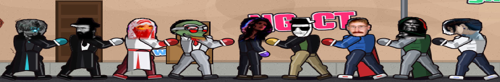
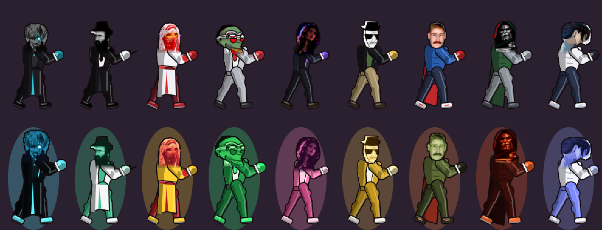
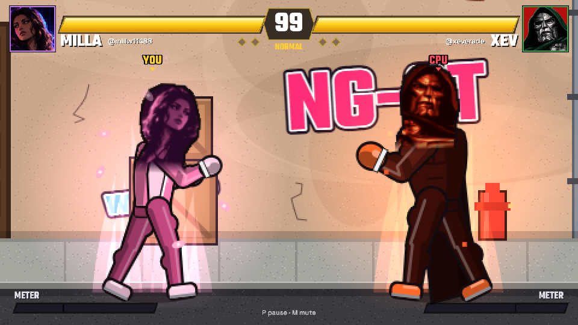

# NG-CT — Timeline Fighters

A 16-bit street fighting game starring nine people from the X timeline. Every fighter's head is their real profile picture, and every move is built from what they actually post.

**Play it:** https://ng-ct.vercel.app



## Modes

- **Arcade**: pick a fighter and beat the other eight in a row. The CPU gets tougher every stage.
- **VS CPU**: one fight against the CPU on Easy, Normal or Hard.
- **2 Players**: two people on one keyboard.

Fights are best of three, with 99-second rounds. The game has synthesized sound effects and two original chiptune tracks. Music and SFX can be toggled on the title and pause screens, and `M` mutes everything.

## Controls

| | 1 player | 2 players (P1 / P2) |
|---|---|---|
| Move / jump | `A` `D` `W` or arrows | `WASD` / arrows |
| Block | hold `S` | hold `S` / `↓` |
| Punch / kick | `J` `K` | `F` `G` / `,` `.` |
| Special | `L` | `H` / `/` |
| Second special | hold `S` + `L` | hold `S` + `H` / `↓` + `/` |
| Super (full meter) | `I` | `T` / `;` |

On phones, on-screen buttons appear during a fight.

Specials cost a third of the meter; the super needs a full bar.

**Moves everyone has**
- **Combos:** `J J K` (1-2-Kick), `J J J` (Uppercut launcher), `K K` (Roundhouse), `J K` (Sweep).
- **Cancels:** any landed hit can be cancelled straight into a special or the super.
- **Low attacks:** hold down and press `J` for a low jab, or `K` for a knockdown sweep.
- **Throw:** forward + `J` up close. It can't be blocked.
- **Guard break:** forward + `K` is a slow overhead that goes through blocks.
- **Dash:** double-tap forward to dash in, or back to back-dash out.

## Roster

| Fighter | Special | ↓ + Special | Super | Transformation | Passive |
|---|---|---|---|---|---|
| **Onepeter** @Onepeterrr | Callout | Diamond Hands | 18-Hour Lock-In | Locked In | Knows What To Do |
| **Skroot** @skrootimburg | Send Floki | Bonding Curve | Doctor's Orders | The Doctor Is In | Last Account |
| **Promise** @sol_promise | $100 Tip | Casino Spin | Giveaway Rain | Jackpot Mode | Big Win |
| **Dave** @solana_dave2 | Dog Wif Hat | Cooking Behind The Scenes | 50x Long | Full Port Long | Incredibly Early |
| **Milla** @millw11488 | Merry Men Volley | Sakura Bloom | Force Push | Sakura Bloom | Audited |
| **Hate** @hate_ofx | Going Lowkey | Ape Big | Making It Big | Made It (gold) | Never Give Up |
| **Exit Liquidity** @exittliquidity | Cape Dash | New Toy | 7 Trench Warriors | Trench General | Exit Liquidity |
| **XEV** @xeverade | BTC To 69k? | Wasted | End Of The World | Doomsday | Knows Alpha |
| **Karo** @karoblaq | Click Click Click | Chicken Change | Calm | Inner Calm | Never Stop Clicking |

Every fighter also has five stats (Health, Speed, Power, Defense, Meter gain). Each one changes how much damage they deal, how much they take and how fast their meter fills. The character select screen in the game shows full descriptions and damage numbers.

## Transformations

Using a super transforms the fighter for 6 seconds. There's a flash, the form's name pops up, and their whole look changes: outfit, colours, a glowing aura and their own particles. Their profile picture is recoloured to match, so it's still clearly them. When the time runs out they change back.

Onepeter's Locked In form also gives +40% damage and +30% speed, and Hate's gold form makes him huge with +50% damage. The other forms only change how the fighter looks.





## How it's built

It's one static `index.html`: no build step and no dependencies apart from Google Fonts. Everything is drawn on `<canvas>`:

- **Fighters:** procedural cel-shaded sprites, drawn at 480×270 and scaled up with hard pixel edges.
- **Heads:** each profile picture in `pfp/` is cut out along a hand-traced outline that includes their own neck and collar, then faded into the body so the head and body read as one character.
- **Transformations:** each form swaps the outfit colours and builds a second, recoloured copy of the head from the same picture.
- **Sound:** all effects are synthesized with WebAudio, and the music is a small chiptune sequencer that plays live in the page.

To run it locally, serve the folder with any static server. For example:

```
python -m http.server
```

Every push to `main` deploys automatically to https://ng-ct.vercel.app through Vercel. The `docs/` folder holds the README screenshots and isn't deployed.

## Credits

The profile pictures belong to their owners on X and are used here as a fan tribute to those accounts. If you're one of them and want your picture changed or removed, open an issue.
